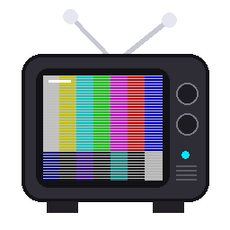

# Cathode

IPTV that feels like a satellite box. Cathode plays your M3U channels with a
program guide, a channel banner on every tune, browse, pause-live-TV, and a
remote-control way of doing everything, in the style of a mid-2000s set-top
box. Your Plex library is On Demand, and downloaded titles are My Recordings.

**Version 4.0** · Windows, macOS, Linux

<br clear="left">

## Looks

Cathode has three skins, switchable any time under **Settings > Picture &
Style > Skin**:

- **Cathode Classic**: Cathode 3's retro-CRT look. Phosphor colour themes,
  pixel fonts, static when you change channel.
- **InDirect / InDirect HD**: a DirecTV-style box. HD after the HR20
  (light info panel, navy grid, amber selection, mini guide); SD after the
  D10/R15 era (saturated blue, yellow selection, 4:3).
- **Plate / Plate HD**: a Dish Network-style box. HD after the ViP622/722
  (silver guide, green selection, numbered Main Menu, RIGHT to browse); SD
  after the 301/522 era (dark navy, yellow selection, 4:3).

Each skin keeps its own colour theme and font. Every skin can use any colour
theme, the colour editor, any font, and the CRT scanlines and vignette.

## How it works

Cathode draws its own window (SDL, through pygame-ce) and plays video with
libmpv inside it. The interface is drawn at the skin's own resolution and
composited over the video on the GPU, along with the CRT effect. Nothing is
redrawn unless something changed, so an idle Cathode costs next to nothing.

## Features

- **Live TV from M3U + XMLTV**: guide with a live picture-in-picture,
  genres ("themes") from the guide data, favourites, channel logos, typed
  channel numbers, PREV for the last channel.
- **Like a box**: start-up screen while it finds its signal, a banner on
  every tune (INFO again for the full description), browse other channels
  without tuning, a mini guide, a signal-loss screen for dead channels.
- **Pause live TV**: pause, rewind and fast-forward through what's buffered,
  then back to live.
- **On Demand (Plex)**: sign in with a code, browse and search your
  libraries as a list or a poster wall, Continue Watching, watchlist, play
  queue, resume points, Skip Intro / Skip Credits, audio and subtitle tracks.
- **My Recordings**: download Plex titles to this computer and watch them
  with no network.
- **Remote control**: keyboard, media keys (so a Media Center remote or a
  FLIRC IR receiver works), any game controller, and the mouse. Every button
  can be remapped.
- **Desktop**: full screen on the monitor you choose, start with the
  computer, keeps the screen awake while it plays.
- Weather in the guide, a diagnostics "signal meter", screensaver, update
  check.

## Install

### Windows

Download `cathode-windows-4.0-portable.zip`, right-click it, **Extract All**,
and run **Cathode.exe**. Everything it needs is inside.

### macOS and Linux (from source, for now)

Install libmpv, then run Cathode with Python 3.10 or newer:

```bash
brew install mpv                       # macOS
sudo apt install libmpv2               # Debian / Ubuntu (Fedora: mpv-libs, Arch: mpv)
python3 -m venv .venv && . .venv/bin/activate
pip install -r requirements.txt
python main.py
```

On macOS with Homebrew on Apple Silicon, if libmpv isn't found:
`export DYLD_FALLBACK_LIBRARY_PATH="$(brew --prefix)/lib"`.

## Using it

On first start Cathode asks for your playlist (an M3U address or file) and,
optionally, an XMLTV guide address. Add more, switch between them, or delete
them under **Settings > Channels**.

### The remote

| Button | Keyboard | Controller |
|---|---|---|
| Channel up / down | Up / Down, PgUp / PgDn (by 10) | LB / RB, D-pad |
| Type a channel | 0-9 then Enter | |
| Guide | G | X |
| Info (twice: description) | I or Tab | Y |
| Menu | C | Back / Start |
| Select | Enter | A |
| Back | Backspace | B |
| Exit (close everything) | Esc | |
| Previous channel | P | R3 |
| Browse / mini guide | B (Plate: Right too) | |
| Themes (genres) | T | |
| Favourite | F | |
| My Recordings | L | |
| Pause / rewind / fast-forward | Space / , / . | |
| Back to live | media Next key | |
| Volume / mute | + - / M | LT / RT, L3 |
| Full screen | W or F11 | |
| Quit | Q | |

Media keys (play/pause, stop, rewind, fast-forward, mute, volume) do what they
say. In menus, number keys pick rows (on Plate's Main Menu, tiles). Remap
anything under **Settings > Remote control**.

### On Demand and My Recordings

Pick **On Demand** from the Main Menu. The first time, it shows a code to
enter at plex.tv/link. Then browse, search, or open Continue Watching or your
watchlist. An item's page has PLAY (or resume), +QUEUE, the watchlist, and
RECORD, which downloads it to this computer. Recordings are in **My
Recordings** (L on the keyboard), play from disk, and work offline.

While a title plays: Select or Space pauses, Left/Right step back and forward,
channel up/down move through the queue, and Select skips an intro or the
credits while that button is up. MENU has audio, subtitles and the queue.

Recordings are kept in your Videos folder (`~/Movies/Cathode` on macOS); set
`download_dir` in the config to put them elsewhere.

## Settings

The Main Menu's **Settings** has Picture & Style (skin, colour theme, font,
scanlines, vignette, motion, colour editor), Channels, Display (full screen,
monitor, start with the computer), On Demand (view, quality, libraries,
server, who's watching, unlink), Remote control, and System (diagnostics,
audio output, weather, updates, start-up screen, screensaver).

The config file is `~/.config/cathode/config.json`. A few things live only
there: `mpv_extra_args` (extra libmpv options such as `["--hwdec=no"]`),
`download_dir`, `nav_repeat_delay` / `nav_repeat_rate`.

## Troubleshooting

- **No picture, but sound**: try `"mpv_extra_args": ["--hwdec=no"]`.
- **Guide is empty**: the playlist's `tvg-id`s must match the XMLTV channel
  ids; Cathode falls back to matching names.
- **Logs**: `cathode.log` (and `cathode.log.1`, the run before) in
  `%LOCALAPPDATA%\cathode\` on Windows and `~/.cache/cathode/` elsewhere.

## Building

PyInstaller builds for the OS it runs on. On Windows:

```bash
pip install pyinstaller
python tools/build_windows.py      # cathode-windows-<ver>-portable.zip, bundles libmpv
```

For development without a playlist or a Plex account, `tools/devtv.py` writes
a test lineup and `tools/devplex.py` runs Cathode against a fake Plex server.

## Project layout

```
main.py             entry point
cathode/
  app.py            the kernel: one UI thread, the screen stack, timers
  video.py          libmpv in-process      gfx.py      window + GPU compositor
  remote.py         every input -> remote buttons
  screens/          live TV, guide, menus, browse, On Demand, playback, ...
  skins/            Classic, InDirect, Plate
  ondemand.py plex.py downloads.py playlist.py epg.py updater.py weather.py
assets/  fonts and icons      tools/  build and dev scripts
```

## License

Cathode is free, non-commercial software under the **GNU GPL v3**
(`LICENSE`). It is not affiliated with, endorsed by, or sponsored by Plex,
DirecTV or Dish Network; the box skins are original work styled after the
period. Bundled fonts, libmpv and libraries keep their own licenses:
[`THIRD_PARTY_NOTICES.md`](THIRD_PARTY_NOTICES.md) and [`LICENSES/`](LICENSES/).
